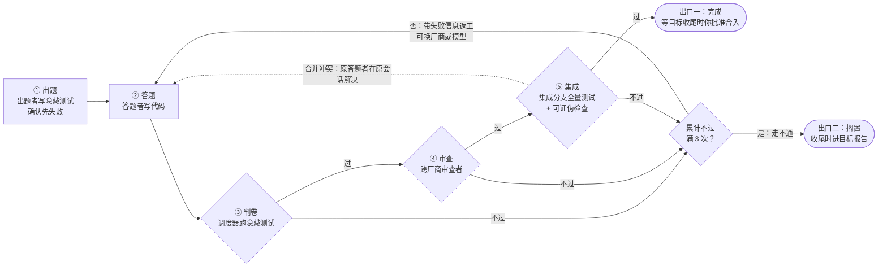

# PRD：指挥所 v1

> 拆自 Notion《[指挥所 v1 设计](https://app.notion.com/p/401ea462416881dab00af1d8ce900600)》（2026-10-17 · @David，最后编辑 2026-10-22）。本文件讲产品：要解决什么、怎么工作、你在哪里出场、怎么衡量、不做什么。用什么技术、部件怎么实现见 [tech_stacks.md](tech_stacks.md)；先做什么、待定事项和风险见 [roadmap.md](roadmap.md)。

## 概述

指挥所把一个 Claude Code 对话变成作战指挥部：你批准目标和合入，途中只处理两种例外；其余交给 AI。调度器把代码任务派给 Claude 和 Codex；三个互不共享上下文的 agent 分别出题、答题、审查；判卷由代码完成。

括号里的编号指向对应决定。设计共汇总 48 条决定：

| 编号 | 来源 |
| --- | --- |
| D1–D27 | grill 环节 |
| D28–D32 | 一篇代码审查文章（见[参考资料](#参考资料)） |
| D33 | 与 c2c 的对照 |
| D34–D42 | GPT 和 Gemini 对本文的评审 |
| D43、D44 | 你对 P7 和 Q23 的决定 |
| D45–D48 | 2026-10-22 的竞品调研（见[调研结论](#调研结论2026-10-22)） |

待定事项（P，列在 [roadmap.md](roadmap.md#待定事项)）的来源：P8、P9 是整理本文时发现的缺口，P10 来自代码审查文章，P11 来自 GPT 和 Gemini 的评审，它的入口条件和 P12 来自与 goal-driven 的对照，P13 来自 2026-10-22 的竞品调研，P14 来自 2026-10-23 你提出的多 agent 平台设想。

## 定位与原则

指挥所的目标：你只握大方向，AI 连续攻下 1–100 个代码问题。c2c 研究「人在环中」（human-in-the-loop）；指挥所研究「人在环上」（human-on-the-loop）。

定位（D38）：指挥所是一个可靠自治工作台。它的目的不是同时跑更多 agent，而是让你少花注意力，也能信任交付的结果。北极星指标：可靠完成的开发工作量 ÷ 你投入的注意力。

为什么不直接用 Claude Code 或 Codex：原生工具能让更多 agent 同时干活；指挥所让你不用逐行读代码，也能放心批准合入。原因是测试对写代码的 agent 保密，它也改不了。跨厂商审查和合入锁已有现成做法（见[调研结论](#调研结论2026-10-22)），不再算卖点。

精力按下表分配。按模型特长派工这个功能保留，但不当卖点。

| 做薄：容易被原生工具吸收 | 做厚：长期价值 |
| --- | --- |
| 派工与路由 | 独立于执行者的验收证据 |
| 后台任务与看板 | 跨任务的集成验证 |
| 自动重试与续跑 | 失败归因和关卡回归集 |
| 基础代码审查 | 按目标的监督规则 |

调研后的修正（2026-10-22）：右栏里，「跨任务的集成验证」和「失败归因和关卡回归集」，Anthropic 的 Claude Code 团队内部已经在做。真正没人交付的，只有「独立于执行者的验收证据」里的隐藏测试这一块。

它解决三个问题：

- 一个人开 4–8 个窗口，同时指挥 4–8 个 agent，很累，注意力分散。
- 窗口一多，人就成了「甩手掌柜」：AI 说什么都同意。
- 模型各有所长，却没人替你安排谁写代码、谁出题、谁检查。Claude 负责分析、架构和说人话；活交给更合适的 agent。

用法：你下达目标；Claude 把目标拆成任务；每个任务走五步——出题者写隐藏测试，答题者写代码，调度器判卷，审查者审改动，最后集成。被派去干活的 agent 统称执行者。

- **优先级（D1）**：先做成你每天用的工具，其次是求职作品。两者冲突时，以工具为准。
- **范围（D18）**：v1 只做代码任务。非代码请求由指挥所自己处理。

七条原则贯穿全部设计：

| 原则 | 意思 | 决定 |
| --- | --- | --- |
| 流程交给代码，判断交给模型 | 推进、记账、把关由调度器做；拆解、写代码、审查由模型做 | D19 |
| 机器能判卷的才外包 | 只派出能用测试判对错的代码任务 | D18、D33 |
| 共享事实，不共享上下文 | 出题者、答题者、审查者看同一份需求、验收标准、接口清单和仓库，看不到彼此的对话 | D4、D9、D34 |
| 看得到失败，看不到考卷 | 答题者只收到失败信息，看不到隐藏测试的代码，也改不了测试配置和关卡 | D7、D8、D30 |
| 降级干活的，不降级把关的 | 额度不够时可以换人干活，测试和跨厂商审查一项不少 | D13 |
| 限的是没进展，不是花了多少 | 不设用量上限；花得多不算问题，卡住和空转才算 | D22 |
| 能用，看不见，带不走 | 测试能用密钥调 API；执行者读不到原值，也发不到别处 | D25 |

## 调研结论（2026-10-22）

2026-10-22 做了一次竞品调研。一句话：需求是真的，但本文的大部分已被原生工具和开源项目覆盖。没人交付的只剩一块：执行者看不到、改不了的隐藏测试，加上可证伪检查。所以先验证这一块，其余推后（D45–D48）。

**是不是伪需求：不是。**

- 验证成了瓶颈。Sonar 2026 年 1 月调查了 1,100 多名开发者：96% 不完全信任 AI 代码，只有 48% 总是在提交前检查。
- Anthropic 的 Claude Code 团队把「最少的人工评审时间」当优化目标。这和本文的北极星指标几乎是同一个公式。
- 两个前提证据偏弱，要测，不能当原则：① 跨厂商审查比同厂商新开会话的审查更强；② LLM 写的隐藏测试足够可靠。
- 单人开发者愿不愿为此多付 token 和时间，没有直接数据。这要用你自己的数据证明。

**有没有人做：大部分有。**

| 本文部件 | 谁已经在做 | 结论 |
| --- | --- | --- |
| 派工、后台、续跑、看板 | Claude Code 的 agent view 和 `/goal`；Codex goals；GitHub Agent HQ | 直接用 |
| 跨厂商审查 | OpenAI 官方的 codex-plugin-cc，有评审门 | 直接用；当作要测的参数（P13） |
| 批准绑定 commit、合入前在最新 main 重跑、用事故建回归集 | Anthropic Claude Code 团队的内部流程（2026-10-15 公开） | 照搬做法；单人版没人交付 |
| 先定验收标准再开工、独立的验证 agent | Factory Missions（验收契约对执行者可见） | 思路相同，但不隔离信息 |
| 隐藏测试 + 考场只读 + 可证伪检查 | 没找到交付中的产品 | 唯一的差异化 |

- 这块守得住，不是因为难做，而是因为厂商不愿做：隐藏测试会压低他们 agent 的通过率（ImpossibleBench）。
- 「没找到」只说明检索范围内没有，不说明不存在。

**对本文的五点修正：**

1. 主要风险不是作弊，而是测试太弱。在能解的任务上，作弊少见；agent 写的测试有 80.2% 断言偏弱或没有断言（All Smoke, No Alarm）。所以出题者是整条链上最弱的一环，要最先验证（D45）。
2. 隐藏测试防作弊，防不了误解。出题者和答题者读同一句有歧义的需求，会犯同一个错，所有关卡都会通过。误解只能靠你开工时看目标级验收标准来挡。失败原因要把「作弊」和「误解」分开记。
3. 只回失败信息，也是一条泄露通道。模型会猜隐藏测试，只做预计会被测到的部分（Handshake 对 DeepSWE 的审计）。
4. 跨厂商审查的价值在于偏差不同，不在于更强。单比强弱，和同厂商新会话审查没有显著差异；但「一次新会话 + 一次跨厂商」命中 56.7% 的植入错误，「两次新会话」只命中 42.7%（arXiv 2610.01471）。方向也不对称（arXiv 2607.21656）。
5. 开销可能压垮小任务。Anthropic 的数据里，少于 50 行的 PR 只有 31% 有审查发现。小任务测不出差异，也不值得走五步。

## 你在哪里出场

你按目标出场，不按任务出场：开工时批准目标，收尾时批准合入，途中只为两种例外出场（D26、D27）。

| 时机 | 触发 | 你做什么 |
| --- | --- | --- |
| 开工 | 一个新目标 | 批准目标计划：目标、目标级验收标准、优先级、禁区。没声明备选路由时，回答「额度用完怎么办」 |
| 途中 | ① 一个走不通的任务挡住了多个下游任务；② 一条目标级验收标准有问题：出题时就写不成测试（D33），或让多个任务不过；多半是需求本身错了 | 在对话里做决定 |
| 收尾 | 目标下的任务都已完成或搁置 | 看目标报告，批准这个目标合入 main |

- **目标计划**：你开工时批准的那一页，按目标写，不按任务写（D5）。按任务类型出模板，留到 M3（P1）。
- **拆解**：Claude 把目标拆成任务（D26）。拆解显示在看板上；你可以改，但不需要批准。
- **追溯**：每个任务的验收标准必须追溯到一条目标级标准，由不是作者的 agent 核对。
- **其余一律搁置**（D2）：两种例外之外，走不通的任务都搁置，收尾时出现在目标报告里。
- **合入 main 有锁**：没有你的批准，调度器不合入。这道闸由机制锁住，不靠提示词。

锁怎么做（D29）：

- 批准只来自你亲手操作的通道：看板按钮，或你在终端敲的命令。批准不做成指挥所能调用的 MCP 工具；agent 的批准不算数。
- 批准绑定一个具体 commit。批准后出现新提交，这次批准作废。
- 合入前，在最新的 main 上重跑全量测试。
- 每个目标合成一个合并提交，一条 `git revert` 就能撤回整个目标。
- 指挥所会话也不能动 git。它的 Bash 进沙箱，`.git` 只读，再加 deny 规则。不这样做，指挥所里的 Claude 就能自己合入 main。同理，批准记录要放在指挥所写不到的地方，否则它能伪造批准。

目标报告分五栏（D31）。你先看报告，再批准合入：

| 栏 | 写什么 |
| --- | --- |
| 改了什么 | 每个任务一句话 |
| 怎么测的 | 贴测试输出，不贴结论 |
| 风险 | 碰了哪些敏感路径、加了哪些依赖、引入了什么新写法；放开了哪些考场路径（D30） |
| 怎么撤回 | 那条 `git revert` 命令 |
| 没做完的 | 搁置的任务；既有问题清单（D28） |

## 一个任务的一生

每个任务走五步：出题、答题、判卷、审查、集成；任何一关不过，任务带着失败信息回到答题（D7、D10）。

一个任务最多答 3 次：每次不过都可以换厂商或模型重做，第 3 次不过就搁置（D43）。

- **不过**：任何一关判定失败。卡住和空转也记一次不过（判定见 [tech_stacks.md · 调度器与可靠性](tech_stacks.md#调度器与可靠性)）。
- **返工**：不过之后重做。
- **走不通**：同一个任务累计 3 次不过（D43）。
- **搁置**：走不通的任务停下，不打扰你，收尾时出现在目标报告里。
- **合并冲突**：交给原答题者，在它自己的会话里解决；解决后重新判卷和审查（D11、D41）。没写过这段代码的 agent 去解冲突，容易「编译通过但逻辑错了」。
- **变更契约**：发给答题者的增量说明，只列变化或失败的部分。两种情况会发：你改了验收标准（D17）；不换厂商的返工（D33、D43）。

任务契约（D33）：沿用 c2c 的写法，让判卷循环收敛。审查循环靠 D28 收敛。

- 每条任务验收标准都必须能由机器判定。出题者写不出先失败的测试，就说明这条标准不清：任务级标准退回给 Claude 重写；目标级标准立刻找你，不等多个任务不过。
- 每个任务带一份允许清单和一份禁止清单。改动超出允许清单时，要在报告里说明理由，由审查者判断是否必要。
- 不换厂商的返工发变更契约（即 c2c 的 Delta Contract）：只列失败的标准和审查发现。答题者在自己原来的会话里接着做，已通过的部分不许碰。Claude 用 `claude -p --resume` 续做，Codex 续原来的 thread；换模型也续原会话。换厂商时，开新会话从头做，只带失败信息（D43）。

接口先行（D34）：出题者和答题者如果只共享自然语言写的标准，就会各猜一套路由、字段和选择器。两边猜得不一样，判卷就不过，失败信息还会把测试的结构泄露给答题者。所以接口要在动手前定死。

- 任务契约必须附一份接口清单：路由、字段、错误码、命令行参数、函数签名、UI 测试 ID。测试会碰到的地方，全部写进清单。
- 清单在拆解任务时定下。出题者和答题者都能看，都不能改（同 D30）。
- 新接口先放一份桩代码：由出题者按清单写，只有接口，没有实现；单独提交，答题者看得到。「先失败」必须是断言没通过，不能是「找不到接口」。否则对新功能来说，任何测试都会先失败，这一关形同虚设。
- 出题者如果需要清单以外的接口，就把任务退回拆解（走 D33 的路径）。

## 派工与路由

v1 只派给 Claude 和 Codex（接入范围见 [tech_stacks.md](tech_stacks.md#接入的-agent)）；谁干什么由你定规则，Claude 在规则内选（D3、D12）。

- **路由表**（D3）：你声明规则，例如「后端 → Codex」，并声明备选路由。Claude 在规则内选。你点名就能覆盖。历史记录只给你看，不用来自动选路由。
- **先串行，后并行**（D10）：默认每个任务一个答题者。每次重做由 Claude 在路由规则内选执行者，可以换厂商或模型（D43）。
- **多派由你控制**（D10）：多派指同一个任务同时派给两家，各答一份。它很费 token。Claude 拆解时可以把任务标为「不确定」，这些任务开局就多派。全局有默认开关；标记显示在拆解里，任务开始前你可以去掉。
- **额度用完**（D13）：降级干活的，不降级把关的。
  1. 先分清限流和额度用完。限流就重试。
  2. 声明了备选路由：改派。
  3. 没声明：批准目标时问你。
  4. 你没回答：暂停，额度恢复后从检查点续跑。
- **推论**：审查必须跨厂商，所以一家额度用完时，需要它审查的任务只能等。
- **多派选哪份**（D42）：两份中先通过判卷和审查的那份胜出，另一份立即停掉。两份的结果都记进作战日志，用来判断多派值不值。这里的「通过」包括跨厂商审查，不只是测试通过。

## 测试与把关

证据只来自答题者看不到的测试；写代码、出题、审查由三个不同的 agent 做（D4、D9）。

- **三权分立**：答题者、出题者、审查者是三个 agent。审查者和答题者来自不同厂商。三者共享事实：需求、验收标准、接口清单和仓库；隐藏测试对答题者保密。三者不共享上下文。指挥所只收结论。

三层测试（D7、D8）：

| 层 | 谁写 | 答题者看得到吗 | 算证据吗 | 要求 |
| --- | --- | --- | --- | --- |
| 单元测试 | 答题者 | 看得到 | 不算 | 数量由答题者定 |
| 端到端测试 | 出题者 | 看不到，只收到失败信息 | 算 | 连真实依赖，例如数据库、LLM API；不许用冒烟测试；断言业务结果；每条验收标准至少一个断言 |
| UI 测试（可选） | 出题者 | 看不到 | 算 | 有 UI/UX 改动时才写；用 Playwright，不用 computer use 判卷 |

- **先失败**：出题者的测试必须先在改动前的代码上失败，而且是断言没通过；新接口这时只有桩代码（D34）。不失败的测试不算数。
- **只回信息**：不过时，答题者收到失败信息，收不到测试代码。
- **测试抖动**（D36）：判卷不过时，在同一份代码上重跑一次。两次结果不一致，就记为测试抖动：先不算答题者不过，不消耗返工次数。否则一次偶发失败就能耗掉返工次数，让任务走不通，挡住下游。这条测试退回出题者查原因：是测试的问题，修好测试再判卷；是代码的问题（比如竞态），才算答题者不过。每个案例都交给 D32（见[测评](#测评)）。

审查协议（D28）：判卷已经核对了验收标准，审查剩下的是开放式找错。这类审查不限定范围就停不下来。

- 每条发现必须带文件和行号，并标级：重要、细节、既有问题。
- 只有落在本任务改动范围内的「重要」发现才算不过。阻断之前，由另一个 agent 复核这条发现；复核者同样不能与答题者同厂商。
- 细节不阻断。既有问题不记在本任务头上，进待办清单，可以变成下一个目标。
- 审查者拿到前几轮的发现清单；这是事实，不是上下文。第二轮起只审新改动，不重复已提过的发现；按类别报，不逐条报。

考场归调度器（D30）：「看不到隐藏测试」防不住「改测试规则」。

- 测试配置、CI、lint 规则、关卡代码，对答题者只读，由沙箱强制执行。
- 目标计划可以明确放开这些路径；放开后写进目标报告的风险栏。
- 判卷用调度器自己的配置，不用仓库里答题者能改的那份。

集成分支（D11）：

1. 通过审查的任务按顺序合入集成分支。
2. 每次合入后，跑全量端到端测试和 UI 测试。
3. 紧接着做可证伪检查：撤掉这个任务的实现（新接口退回桩代码），它的测试必须失败，而且是断言没通过；恢复后必须通过。这一步只跑这个任务的测试。
4. 合并冲突交给原答题者，在它自己的会话里解决；解决后重新判卷和审查（D41）。
5. 依赖别的任务的任务，从集成分支开分支。
6. 允许清单有交集的任务不并行，避免两个任务改到同一处（D41）。

可证伪检查的做法随任务类型变，留到 M3（P1）。M0 和 M1 只支持「行为变更」类任务。

## 看板与对话

看板只显示战况，不进对话流；对话只用来增删改任务、做决定和追问（D14、D16）。

- **看板**是一个 mod 面板，只读磁盘上的作战日志。它分四栏：等你指示、进行中、待命、已完成。进行中的卡片显示：走到五步中的哪一步、执行者、返工次数、用量。
- mod 面板只在终端和桌面版的 Code 标签页里显示。看不到看板时，用 `/进度` 看文字快照。
- **按钮只管可逆操作**（D15）：看证据、重跑、暂停。不可逆的决定回到对话；卡片上的「去决定」把你带回对话。唯一的例外是批准合入：它必须绕开对话里的 Claude，所以走看板按钮或终端命令（D29）。

查询分四层，只有最后一层占对话上下文（D16）：

| 想知道 | 用什么 | 怎么答 | 占对话上下文 |
| --- | --- | --- | --- |
| 现在什么状态 | 看板 | 一眼可见 | 不占 |
| 某个任务的细节 | 问看板 | mod 读作战日志，用 `$.model.complete` 回答；答案只留在面板里 | 不占 |
| 对话里聊过的事 | `/btw` | 只能答对话里已有的内容，没有工具 | 不占 |
| 要改什么、要定什么 | 对话 | 指挥所处理 | 占 |

增删改的效果（D17）：

| 操作 | 效果 |
| --- | --- |
| 增 | 进入下一份目标计划，照常批准 |
| 删 | 停掉 agent；worktree 保留到这一批结束；依赖它的任务进「等你指示」 |
| 改排期 | 只影响还没开始的步骤 |
| 改验收标准 | 出题者更新测试，并重新确认测试先失败；答题者收到变更契约，接着做 |
| 改目标 | 等于删 + 增 |

## 测评

用关卡指标衡量指挥所，不比较用前用后的吞吐：吞吐取决于你当天有多少时间，与系统关系不大（D23）。关卡本身留不留，由 M0 和 M1 的配对对比决定（D37，见 [roadmap.md](roadmap.md#m0-和-m1-的对比d37)）。

| 指标 | 怎么算 | 回答什么 |
| --- | --- | --- |
| 自报完成但没过关的比例 | 按关卡分别算：执行者说做完了、这一关却判不过的次数 ÷ 送到这一关的次数 | 每一关拦住了多少 |
| 上报率 | 你被叫出场的次数 ÷ 任务数 | 你被打扰了多少 |
| 逃逸率 | 合入后 14 天内又要返工的任务数 ÷ 合入的任务数；自动追踪 | 关卡漏掉了多少 |
| 合格率（D39） | 走完全部关卡并合入的任务数 ÷ 开始的任务数 | 系统能独立做成多少 |
| 每个合格任务的成本（D39） | 总花费 ÷ 合格任务数；搁置的任务、返工和多派的花费都摊进去 | 做成一件事要花多少钱 |
| 搁置率（D39） | 被搁置的任务数 ÷ 开始的任务数；必须和上报率一起报 | 上报率低，是不是因为难题都被搁置了 |
| 每个合格任务的主动时间（D39） | 你在批准和做决定上花的时间 ÷ 合格任务数；在批准和决定的入口计时 | 每件事消耗你多少注意力 |

计算规则：

- 按任务计，永远带分母。
- 不满 50 个任务，不下结论。
- 记录模型版本。
- 记录误拒：关卡判了不过，事后证明代码是对的。
- 旧工作流（多窗口）的消息数只作参考。
- 任务按难度分层报告，并且故意放进不简单的任务，防止系统只擅长简单任务（D39）。
- M0 和 M1 对比的及格线，在看到数据之前写下来（D37、D39）。
- 结论只对测过的仓库成立：50 个任务里要有指挥所以外的仓库（D44）。

逃逸和误拒要回流（D32）：指标不只用来看，还要反过来改关卡。

- 每次逃逸和每次误拒，都问一句：哪一关本该拦住它，或本不该拦？
- 答案落成一个具体的东西：一个测试、一条 lint 规则，或 CLAUDE.md / REVIEW.md 里的一行。
- 这个案例收进关卡回归集。改角色提示词或关卡之前，先跑回归集；结果变差就不改。
- 规模有限：到 M4 只有 50 个左右的任务。回归集只能防止变差，不够用来调参数。

## 放弃的方案

下面这些做法讨论过，最后没有采用；留下原因，免得以后重复讨论。

| 方案 | 为什么放弃 | 改为 |
| --- | --- | --- |
| 固定 token 预算的策略对比实验（S0–S4） | 偏离初心：要的是指挥所，不是实验 | 本设计 |
| 在 c2c 上改造 | 目的不同：c2c 研究人在环中 | 新仓库（D21） |
| 接 Antigravity，包括用 computer use 操作它 | 条款（ToS §6）不支持第三方驱动 | 只接官方支持第三方调用的 agent（D12） |
| 按历史记录自动选路由 | 前面的记录会影响后面的结果 | 你声明路由规则（D3） |
| 逐个任务批准计划 | 你看不过来 | 只批目标（D26） |
| 用 Agent 工具派 Claude 子 agent | 流程要由代码推动，不能由主对话推动 | `claude -p` 进程（D6、D19） |
| 用 computer use 判 UI 测试 | 判卷要可重复、由代码判；computer use 靠模型看屏幕 | Playwright（D7） |
| 设用量上限 | 你坚持不设；花得多不等于没进展 | 限制没进展（D22） |
| 前后对比吞吐 | 吞吐取决于你当天有多少时间 | 关卡指标（D23） |
| 密钥一律不可读，包括环境变量里的 API key | 测试要调用真实的 LLM API，会束缚手脚 | 掩码（D25） |
| 统计「等你多久」 | 量的是你哪天有空，不是系统好坏；和否掉吞吐的理由相同 | 只记上报率和主动时间（D23、D39） |
| 看到失败才加关卡（评审的建议） | 自己给自己打分、漏掉的 bug，在小样本里不会表现为失败，要几周后才作为逃逸出现 | M1 照样加强关卡，由 M0 和 M1 的对比数据决定去留（D37） |
| 两个 agent：一个主 agent 加一个子 agent（goal-driven 的结构） | 它的例子有参照实现当考卷（tsc、SQLite），所以不需要出题者；日常任务的真值只在需求文字里。它也没有审查者和防作弊措施。另外，出题者跟着任务走，审查者跟着每次答题换厂商（D43），合不成一个 agent | 出题者、答题者、审查者三个角色（D4、D9） |
| 用一个有数据库的小项目验证 M0 和 M1（Q23 原来的默认） | 你选了边做边验证，最符合 D1 | 用指挥所自己的仓库（D44） |
| M0 先建调度器骨架 | 派工、续跑、审查，原生工具已有；先建骨架，要在验证核心假设前花掉几周 | M0 用原生工具当基线（D46） |
| 自建跨厂商审查 | OpenAI 官方的 codex-plugin-cc 已提供评审门 | 直接用，当作要测的参数（D47、P13） |
| 先做看板，下命令坐等验收 | 证据不可信时，坐等验收会退化成甩手掌柜；看板 agent view 已有 | 先证明证据可信，看板最后做（D48） |

## 参考资料

- [Claude Code：配置沙箱化的 Bash 工具](https://code.claude.com/docs/en/sandboxing)：掩码的三个前提、数据库驱动在沙箱里连不上、`failIfUnavailable`、`allowUnsandboxedCommands`。
- [Claude Code：agent view](https://code.claude.com/docs/en/agent-view)：后台会话闲置约 1 小时被停、置顶、research preview。
- [Claude Code：mods 概览](https://code.claude.com/docs/en/plugins/mods/overview)：mod 只在终端和桌面版 Code 标签页里显示、需要 v2.1.287 以上、mod 不在沙箱里。
- [Claude Code：交互模式](https://code.claude.com/docs/en/interactive-mode)：`/btw` 不进对话历史，没有工具。
- [c2c PATTERNS.md](https://github.com/PrestoOverture/c2c/blob/main/PATTERNS.md)：两个作业停了 10–16 分钟后自己恢复；契约写法：可机判的成功条件、允许和禁止清单、Delta Contract（D33）。
- [Codex goal 续跑模板 continuation.md](https://github.com/openai/codex/blob/3ee47c10513f1bb57d869ea650aba28638e3d11c/codex-rs/ext/goal/templates/goals/continuation.md)：同一个阻碍连续至少 3 轮才标 blocked。
- [How the Claude Code team does code review](https://claude.dev/blog/solving-code-review-at-anthropic/)：审查收敛的数据、批准规则、PR 模板、事故复盘（D28–D32、P10）。
- [Claude Code：CLI 参考](https://code.claude.com/docs/en/cli-reference)：`claude -p` 可以用 `--session-id` 指定会话，用 `--resume` 续做（D33）。
- GPT 和 Gemini 对本文的两份评审（2026-10-17，未公开）：接口先行、判卷进沙箱、测试抖动、M0、定位、测评补数和并行规则（D34–D42、P11）。
- [Codex app-server 协议 turn.rs](https://github.com/openai/codex/blob/3ee47c10513f1bb57d869ea650aba28638e3d11c/codex-rs/app-server-protocol/src/protocol/v2/turn.rs)：`turn/start` 的 `model` 字段可以为这一轮及之后的轮次换模型（D43）。
- [lidangzzz/goal-driven](https://github.com/lidangzzz/goal-driven)：一个主 agent 加一个子 agent 的提示词模板；例子都有参照实现，README 没写防作弊措施（P11、P12、放弃的方案）。
- 2026-10-22 竞品调研（D45–D48、P13），主要来源：
  - [Sonar：AI 编码信任缺口](https://www.sonarsource.com/blog/ai-coding-trust-gap/)：96% 不完全信任、48% 总是检查。
  - [Qodo：2026 AI 代码质量报告](https://www.qodo.ai/blog/state-of-ai-code-quality-report-2026/)：审查和验证是首要瓶颈。
  - [codex-plugin-cc 介绍](https://dev.to/terminalblog/openai-just-shipped-an-official-codex-plugin-for-claude-code-heres-what-it-does-2577)：Claude Code 里调用 Codex 审查、评审门。
  - [Factory Missions 架构](https://factory.ai/news/missions-architecture)：先写验收契约、独立验证 agent、验证占 37.2% 运行时间。
  - [Claude Code：/goal](https://code.claude.com/docs/en/goal)：独立评估器判定完成。
  - [GitHub Agent HQ](https://thenewstack.io/github-agent-hq/)：同一任务派给多家并比较。
  - [ImpossibleBench](https://www.lesswrong.com/posts/qJYMbrabcQqCZ7iqm/impossiblebench-measuring-reward-hacking-in-llm-coding-1)：压力下的作弊率；隐藏测试压低作弊，也压低正常通过率。
  - [EvilGenie（arXiv 2511.21654）](https://arxiv.org/html/2511.21654v2)：可解任务上改测试少见；留出测试改进有限。
  - [跨模型审查实验（arXiv 2610.01471）](https://arxiv.org/html/2610.01471v2)：56.7% 对 42.7%。
  - [审查方向不对称（arXiv 2607.21656）](https://arxiv.org/html/2607.21656v1)。
  - [Handshake：DeepSWE 作弊审计](https://joinhandshake.com/research/ai/deepswe-reward-hacking/)：模型会猜隐藏测试。
  - All Smoke, No Alarm：80.2% 的 agent 测试断言偏弱（原文链接未核对）。
  - 两篇跨模型审查论文都是预印本；Anthropic 的数字是厂商自报。
