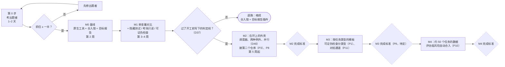

# 路线图：指挥所 v1

> 拆自 Notion《[指挥所 v1 设计](https://app.notion.com/p/401ea462416881dab00af1d8ce900600)》。本文件讲先做什么、怎么验证、还没定的事和要盯住的风险。指标定义见 [prd.md · 测评](prd.md#测评)，技术待核实项见 [tech_stacks.md](tech_stacks.md#待核实)。

## 里程碑

先花两天证明出题者靠得住；再用原生工具当基线跑 M0；然后只加隐藏测试这一个变量做对比（M1）；赢了才做「人在环上」的外壳、调度器、并行和看板（D24、D37、D45–D48）。

| 步 | 做什么 | 多久 | 停下来的信号 |
| --- | --- | --- | --- |
| 第 0 步：考出题者（D45） | 从 SWE-bench-Live 挑 10–20 题，只要 issue 晚于所用模型训练截止日的（取出题者各模型中最晚的截止日）。只给出题者 issue 正文和接口，不给 gold patch 和官方测试，让它写测试。测试在 base commit 上断言失败、打上 gold patch 后通过，才算抓住。再对 gold patch 改到的函数做变异，看测试能拦住多少（变异测试） | 1–2 天 | 抓住不到一半：先修出题者，不往下走 |
| 第 1 步：M0 基线（D46） | 不建调度器。派工、续跑、审查用 Claude Code、`/goal` 和 codex-plugin-cc 的评审门。只补两样：合入锁（D29）和五栏目标报告（D31）。开始记账：主动时间、逃逸、失败原因（作弊还是误解） | 第 2 周 | 无；从这周起天天用 |
| 第 2 步：M1 单变量对比（D47） | 只加一个变量：隐藏测试 + 考场只读（D30）+ 可证伪检查。用一个最小脚本串起出题、答题、判卷，不建完整调度器。同一批任务两种方式各跑一遍，每个至少 200 行，先做 20 对 | 第 3–4 周 | 判定线开工前写下（D37）。例：比基线多拦下的真缺陷少于 2 个，或主动时间不降反升，就走退路 |
| 第 3 步：在环上的外壳（D48） | 赢了才做：只在开工和收尾找你、两种例外（D2、D27）、确定性调度器（D19、D20）、并行（D40）。例外的触发线按前几周的数据定。看板最后做，先用 agent view | 第 5 周起 | 没赢的退路：缩成「合入锁 + 目标报告」插件，照样自己用 |

- 第 0 步的判定方法就是可证伪检查。它在这里是测量工具，不是产品。
- 第 0 步为什么用公开题，不用自己的仓库：自己的仓库没有成批、已知的 bug 修复提交。SWE-bench-Live（[论文](https://arxiv.org/abs/2505.23419)）持续收新 issue，每题带 Docker 镜像，按日期筛掉训练截止日前的题就避开了污染。两个坑：
  - 断言失败也可能与 issue 无关（[arXiv 2509.01616](https://arxiv.org/pdf/2509.01616)）。要人工核对：失败的断言测的是 issue 描述的行为，才算抓住。
  - 题型偏乐观：benchmark 是写得清楚的 bug 报告，日常是模糊的新功能目标。这个差距留给 M1 用自己的仓库量（D44），第 0 步不管。
- 第 0 步顺带对照官方 `FAIL_TO_PASS` 测试：出题者抓住了哪些官方测试没抓的，漏了哪些官方测试抓住的。
- 求职材料从第 1 步开始攒。卖点是对比数据，不是功能数量；负面结果也算。

- **M0 前置条件**（D35，原因见 [tech_stacks.md · 沙箱与安全](tech_stacks.md#沙箱与安全)）：M0 用指挥所自己的仓库验证（D44），所以写 M0 之前，先证明这个仓库的测试能在沙箱里跑：git 操作、起进程、杀进程。多数数据库驱动在沙箱里连不上（见 [tech_stacks.md · 待核实](tech_stacks.md#待核实)），所以连数据库服务的实验（比如通过 unix socket 连 Postgres）挪到 M2 开头，接第二个仓库时做（P3）。

每个菱形代表上一段的完成标准：达到了，才进入下一段。虚线菱形的标准还没定或原文未写明：M3 的标准待定（P9）；M2、M4 的标准只画在 Notion 原图（10-17 版）里，没有文字，这里按原文文字复原，需要补上。M2–M4 各段的内容是从原文里标了「M2 / M3 / M4」的条目归拢出来的；M0、M1 以上表为准。

## M0 和 M1 的对比（D37）

- M0 不建调度器骨架（D46），只用原生工具，加上合入锁和目标报告。关卡用弱的一套：答题者自己测，跑现有的全量测试，Codex 评审门审查，再由一个不是作者的 Claude 新会话读 diff，你读目标报告后批准。用它跑指挥所自己仓库里的真实任务（D44），每个至少 200 行，先做 20 个（D47）；记下失败原因（作弊还是误解）、你花的时间和花费。
- M1 只加一个变量：隐藏测试、考场只读和可证伪检查；接口先行随出题一起加（D47）。跨厂商审查两组都有，不算变量（P13）。然后从同一个起点重跑 M0 那批任务，逐个对比。
- 再用 M1 的隐藏测试检查 M0 已经合入的代码。查出来的问题，就是只靠 agent 审查和读 diff 漏掉的。
- 强关卡留不留，由这组对比数据决定，不等失败自己出现（理由见 [prd.md · 放弃的方案](prd.md#放弃的方案)）。20 个任务只够证明一道关卡有用，不够证明它没用：一道关卡在这批任务里没拦住任何问题，不能只凭这一点去掉它（测评的计算规则：不满 50 个任务，不下结论）。这组对比也回答了「为什么不直接用原生工具」这个问题。

## M0 实施计划

第 0 步已过（2026-10-23，Sonnet 出题，51 题抓住 42 题，82%；见 [history.md](history.md)）。M0 按下面的顺序做，前四项用普通 Claude Code 写（先自举，D44）。

| 编号 | 做什么 | 完成标准 |
| --- | --- | --- |
| M0.0 前置（D35） | 在 Claude Code 沙箱里跑本仓库的测试：worktree 里的 git 提交、起进程、杀进程。配置照 [tech_stacks.md · 沙箱与安全](tech_stacks.md#沙箱与安全)：`failIfUnavailable`、不放行沙箱外命令、经 `--settings` 传入 | 一个可重跑的检查脚本，三项全过；顺带答掉待核实里的「沙箱会不会挡住 worktree 里的 git 提交」和「`.git` 只读后还能不能提交」。后者答案是不能时，先改 M0.1 的做法再往下走。**已完成（2026-10-23）**：`bun scripts/sandbox/check.ts` 19 项全过；`.git` 整个只读时 worktree 提交不了，所以 M0.1 改为只锁 main 的 ref 和 `packed-refs`（见 [tech_stacks.md · 已核实](tech_stacks.md#已核实m002026-10-23macos)） |
| M0.1 合入锁（D29） | `hq approve <目标>`：你在终端运行，批准绑定集成分支当前的 commit，记录写进 `~/.hq/approvals/`（沙箱禁止 agent 写）。执行者的沙箱用 `denyWrite` 锁住主仓库的 `refs/heads/main` 和 `packed-refs`，`.git` 其余部分照常可写（M0.0 实测）。合入：批准的 commit 必须等于集成分支最新提交，在最新 main 上重跑全量测试，每个目标一个 `--no-ff` 合并提交，输出撤回用的 `git revert` 命令。main 的更新由 git 的 `reference-transaction` 钩子把关，没有批准记录就拒绝；沙箱禁止 agent 改钩子 | 假执行者的端到端测试覆盖：未批准、批准后又有新提交、测试不过、agent 自己改 main 或伪造批准，四种都被拒。**已完成（2026-10-23）**：`hq/`，9 个测试；守卫钩子还没装到本仓库（装了以后直接往 main 提交要带 `HQ_ALLOW_MAIN=1`） |
| M0.2 目标报告（D31） | `hq report <目标>` 生成五栏：改了什么（每个任务一句话）、怎么测的（原始测试输出）、风险（敏感路径、新依赖）、怎么撤回（revert 命令）、没做完的（搁置的任务、既有问题清单） | 在一个假目标上生成完整的五栏。**已完成（2026-10-23）**：`hq report <目标>`；测试输出取自和 `hq merge` 同样的合并预演与沙箱；`hq approve` 只认有绿色报告的那个 commit；搁置的任务和既有问题来自目标分支上的 `goals/<目标>.json` |
| M0.3 记账 | 每个任务一行 JSONL：base commit（M1 从同一起点重跑）、模型、花费、每道关卡的结果、失败原因（作弊还是误解）、主动时间（从打开报告到 `hq approve`，D39）、逃逸（合入后 14 天内返工，用 `hq escape` 标记） | 汇总脚本按测评的口径算出各项指标，带分母。**已完成（2026-10-23）**：记录改成只追加的事件流（`~/.hq/ledger/<仓库>/events.jsonl`），`hq stats --tasks` 折成每个任务一行；hq 自己记看报告、批准（含主动时间）和合入，其余用 `hq task …`、`hq escalate`、`hq escape` 记。每个任务至少 200 行这一条还没自动核对 |
| M0.4 版本分开（D44） | `hq` 从固定安装版本运行（`~/.hq/versions/<sha>`，保留上一版），合入后重新安装 | 改 worktree 里的 `hq` 源码不影响正在运行的版本；能回退到上一版。**已完成（2026-10-23）**：`hq install` 从 main 的提交取 `hq/`（`git archive`）装进 `~/.hq/versions/<commit>`，`~/.hq/current` 指向它，被替换的留作 `previous`，`hq rollback` 对调；启动器 `~/.hq/bin/hq` 和守卫钩子都跑 `current`；`hq merge` 合入改了 `hq/` 的目标后自动重装。本仓库已装 `85f4715` |
| M0.5 跑任务 | 本仓库的 20 个真实任务，每个至少 200 行。关卡用弱的一套：答题者自测、全量测试、Codex 评审门、Claude 新会话读 diff（记作 `claude_diff`），你读目标报告后批准 | 20 个任务都有记账；从第 1 步起天天用 |

### M1 判定线（D37，2026-10-23 定，M0 数据出来之前）

真缺陷：合入前没拦下、事后证实的行为错误。来源只有两种：M1 的隐藏测试在 M0 已合入的代码上判不过，且确认错在代码（不是测试错或需求歧义）；合入后 14 天内的逃逸。细节、风格、既有问题不算。

| | 条件 | 不满足时 |
| --- | --- | --- |
| 主条件 | 同一批 20 个任务上，M1 合入前拦下的真缺陷比 M0 多至少 2 个 | 走退路 |
| 注意力条件 | M1 每个合格任务的主动时间不高于 M0 | 走退路 |
| 护栏 ① | M1 合格率不低于 M0 减 15 个百分点 | 先修关卡重跑一次，只一次 |
| 护栏 ② | M1 误拒率不超过 20%（误拒 ÷ 关卡不过的次数） | 同上 |
| 只记录 | 每个合格任务的花费；超过 M0 的 2 倍要在结论里写明 | 不卡判定 |

两个条件都满足算赢，进第 3 步；否则走退路（缩成「合入锁 + 目标报告」插件）。20 个任务只够证明关卡有用：没过线时结论写「M0 规模下没显出差别」，不写「隐藏测试没用」。

### M0 的 20 个任务（2026-10-23 定）

都来自本仓库，都是行为变更类，每个至少 200 行（含测试）。M1 的最小脚本不在其中：它和合入锁一样用普通 Claude Code 先写好（D44），否则 M1 要用它重跑它自己。⚠ 是改关卡的任务，按上面「用自己的仓库验证」的规矩审。

| # | 难度 | 任务 |
| --- | --- | --- |
| 1 | 易 | `hq goal new <名>`：建目标分支、worktree 和 `goals/<名>.json` 骨架 |
| 2 | 易 | `hq status`：各目标的分支、报告、批准状态，未结束的任务 |
| 3 | 易 ⚠ | 记账核对行数：任务结束时算改动行数，`hq stats` 标出不足 200 行的 |
| 4 | 易 ⚠ | `hq stats` 按目标或时间筛选，导出 CSV |
| 5 | 易 ⚠ | 报告里的测试输出去掉 ANSI 颜色码和 hq 自测时的批准提示 |
| 6 | 易 | eval：合并多次 run 的结果，同一题取最新判卷 |
| 7 | 中 | eval：出题提示词 v2（只断言 issue 描述的行为），加在第 0 步漏掉的 9 题上的 A/B 脚本 |
| 8 | 中 | eval：变异测试：一次撤销 gold patch 的一块，统计测试拦下多少 |
| 9 | 中 ⚠ | 逃逸候选：`hq merge` 时找出近 14 天合入的目标里，后来被 fix 或 revert 碰到同样文件的 |
| 10 | 中 ⚠ | `hq review <目标>`：调 codex-plugin-cc 审目标的 diff，按 D28 分级，记成关卡结果 |
| 11 | 中 ⚠ | 报告的风险栏：检测新 import、新的进程或网络调用 |
| 12 | 中 | 花费自动入账：从 `claude -p` 的输出流或会话记录解析花费 |
| 13 | 中 | step0 workflow：拉镜像前检查磁盘，不够判 `excluded_disk`；可选更大的 runner |
| 14 | 中 ⚠ | `hq sync <目标>`：把 main 的新提交并进目标分支，旧批准作废 |
| 15 | 难 | `hq replay <任务>`：按记账里的 base commit 重建任务现场（M1 从同一起点重跑要用） |
| 16 | 难 | 并行环境分配（D40）：`hq env <任务>` 分配端口段、临时目录、数据库名，加锁防冲突 |
| 17 | 难 | Codex 执行者的沙箱核实：用 srt 包住 Codex，照 M0.0 做检查脚本 |
| 18 | 难 | eval 的写测试流程用假的 `claude` 和 `docker` 测起来 |
| 19 | 难 ⚠ | 合入排队：多个目标串行合入，main 动了就重做合并预演 |
| 20 | 难 | 验收标准追溯：每条任务级标准对应一条目标级标准，由不是作者的 agent 核对 |

## 用自己的仓库验证（D44）

M0 和 M1 的任务都来自指挥所自己的仓库，边做边验证。这最符合 D1。要守三条规矩，并接受一个代价：

- **先自举**：合入锁、目标报告和第 2 步的最小脚本，用普通 Claude Code 写。它们能跑以后，才接自己仓库的任务。
- **运行的版本和被改的版本分开**：调度器从固定的安装版本运行，任务只改 worktree 里的源码。合入后重新安装，新版本才生效；保留上一版，出问题就回退。不这样做，答题者改的就是正在给它判卷的代码（D30）。改关卡、沙箱或测试配置的任务，由 Claude 新会话逐行读 diff，专门回答「有没有放松任何一条拒绝、有没有往外发东西」；读过且没问题，才在沙箱外跑 hq 那些嵌套时被跳过的测试（ADR-4）。你不读 diff（2026-10-23 的决定）。
- **端到端测试用假执行者**：假执行者走真实的通信协议，配真实的 git、文件和进程。真实模型的输出不稳定，每跑一次都花额度；c2c 也是用 mock 的 Codex 测的。这是 D7 的例外：换掉的只是执行者背后的模型，被测的调度器、git 和进程都是真的。真实执行者的检验，就是你每天用它干活。
- **代价**：这个仓库没有要连的数据库，D7 的「连真实数据库」测不到。连数据库的测试留到 M2 开头，接第二个仓库时做（P3）。结论也只对测过的仓库成立（见测评的计算规则）。

## 待定事项

共十一件事待定、八件事待核实（见 [tech_stacks.md](tech_stacks.md#待核实)）、四个风险要盯住。

| 编号 | 待定事项 | 何时定 |
| --- | --- | --- |
| P1 | 按任务类型的目标计划模板，含可证伪检查的类型 | M3 |
| P3 | 测试环境：接第二个仓库（D44），一次性数据库、LLM 测试的稳定性、密钥怎么给 | M2 开头 |
| P4 | 主观的 UX 判断 | v1 之后 |
| P6 | 项目名 | 发布前 |
| P8 | 集成分支按目标分开，还是共用一条。按目标合入 main（D27）要求能单独合入一个目标，所以倾向按目标分开 | M2 前 |
| P9 | M3 的完成标准 | M3 前 |
| P10 | 低风险目标自动合入，并配熔断：逃逸率上升时自动退回人工批准。风险等级由改动决定，不由作者自报 | M4 有数据后 |
| P11 | 对拍通道：任务有外部真值时（重构有旧版本，移植有原实现），出题者只出输入，期望结果由参照实现给（对拍）；跨厂商审查保留；可证伪检查的做法随 P1 定。入口看有没有外部真值，不看改动大小。走不走由审查者看到实际 diff 后确认，不由拆解时自己声明 | M3（随 P1） |
| P12 | 审查者和出题者同厂商时，审查是否接着出题者的会话做。好处是省一次读仓库；代价是出题者读错需求时，两道检查会一起错。M1 先分开跑 | M1 有数据后 |
| P13 | 跨厂商审查留不留。它是要测的参数，不是原则：价值在偏差不同，不在更强。M1 两组都带；之后单独比「新会话审查」和「跨厂商审查」 | M1 有数据后 |
| P14 | 多 agent 接入与自由分配角色：执行者做成可插拔的适配层，接入更多 agent（候选 OpenCode、Hermes Agent），出题者、答题者、审查者都可按规则指定给任一 agent，例如 Codex 出题、OpenCode 答题。边界：每接一个 agent 先过 D12 的条款检查；审查者与答题者不同厂商的约束不变；Orchestrator 仍是 Claude Code 对话（D21），流程仍由确定性调度器推动（D19）。和定位 D38（不追求同时跑更多 agent）有张力，要先说明它怎么降低你的注意力成本 | v2 |

## 风险

- mod 和后台会话都是新功能；agent view 仍是 research preview，界面和快捷键可能变。
- Claude 额度是单点：指挥所和 Claude 执行者用同一份额度。
- 看板 mod 不在沙箱里：mod 以你的权限运行，能读文件和环境变量。看板应只读作战日志，不执行执行者产出的任何内容。
- 原生吸收：Anthropic 10-15 公开的评审流程已覆盖本文多数「做厚」部件，单人版可能很快出现。差异化只剩隐藏测试这一块（D47）。
