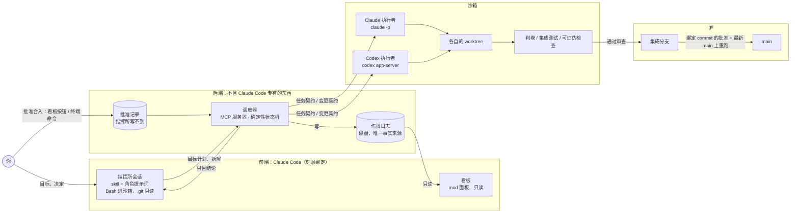

# 技术栈：指挥所 v1

> 拆自 Notion《[指挥所 v1 设计](https://app.notion.com/p/401ea462416881dab00af1d8ce900600)》。本文件讲用什么技术做、系统由哪些部件组成、调度器和沙箱怎么实现、哪些技术问题待核实。产品行为见 [prd.md](prd.md)，计划见 [roadmap.md](roadmap.md)。

## 选型总览

原文定了外部工具和交付形态，没写实现语言。实现语言和运行时已定为 TypeScript + Bun（2026-10-22）；下表列出每一层的选型和依据。

| 层 | 选型 | 依据 |
| --- | --- | --- |
| 语言 | TypeScript（ESM） | mod 只能用 JavaScript / TypeScript 写；Codex 驱动代码从 c2c 复制，c2c 的 MCP 服务器就是 TypeScript。前后端一种语言 |
| 运行时 | 开发和测试用 Bun；发布产物跑在 Node ≥ 18 | 沿用 c2c（`bun src/server.ts` 启动、`bun test`、`tsup` 打包到 `dist/`） |
| 调度器 | MCP 服务器，`@modelcontextprotocol/sdk` | 原文：交付形态含「MCP 调度器」；核心状态机不依赖 MCP（D20），MCP 只是外壳 |
| 契约与日志的校验 | zod | 沿用 c2c；任务契约、报告、作战日志用同一套 schema |
| 作战日志存储 | 仓库内一个状态目录下的 JSON 文件，先写临时文件再 rename 原子替换 | 原文：作战日志在磁盘、是唯一事实来源、重启从它续跑（D20、D21）；c2c 的 store 也是这种写法。目录名随项目名定（P6） |
| Claude 执行者 | `claude -p` 无头子进程；`--session-id` / `--resume` 续会话 | D6、D33 |
| Codex 执行者 | `codex app-server`（JSON-RPC），复用 c2c 的 app-server 客户端、goal 循环、用量提取、看门狗 | D6、D21 |
| 代码隔离与集成 | git CLI：每个执行者一个 worktree，集成分支，按目标一个合并提交 | D11、D29 |
| 隐藏测试 | 跟随目标仓库的测试框架；UI 测试用 Playwright | D7 |
| 沙箱 | Claude Code 沙箱（经 `--settings` 传配置）；Codex 侧视核实结果用 sandbox-runtime（srt）包裹 | D25、D35 |
| 看板 | Claude Code mod：TypeScript hooks 模块，`ui.render` 画面板，`$.model.complete` 答追问 | D14、D16 |
| 前端入口 | Claude Code 插件：skill + 角色提示词 + 上面的 MCP 调度器和 mod | D21 |
| 调度器自身的测试 | `bun test` + 假执行者（mock 的 `claude` / `codex` 进程，走真实协议） | D44；c2c 用 mock-codex 测 |

## 系统组成

调度器是唯一推动流程的部件：指挥所只收结论，看板只读磁盘，执行者只在自己的 worktree 里干活。

合入 main 只有一条路：先进集成分支，再等你批准。

- **执行者**（D6）：两种执行者用同一套任务契约、报告和作战日志格式。任务契约是交给执行者的任务说明，含需求、验收标准、允许和禁止清单、接口清单（D33、D34）。

| 执行者 | 运行方式 |
| --- | --- |
| Claude | `claude -p` 无头进程 |
| Codex | `codex app-server`（JSON-RPC） |

- **作战日志**：磁盘上的任务记录，是唯一的事实来源。调度器写它；看板只读它；重启后从它续跑。
- **一个仓库一个指挥所**（D21）：状态存在仓库里的一个目录。只有执行「开工」的会话持有锁。
- **前后端分界**（D21）：前端刻意绑定 Claude Code；后端不含任何 Claude Code 专有的东西。

## 接入的 agent

- 只接官方支持第三方调用的 agent（D12）。v1 只有 Claude 和 Codex。
- Antigravity 不接。
- Gemini CLI 留到 v2 评估，先查个人账号的条款。

## 交付形态与仓库

- **交付形态**（D21）：一个 Claude Code 插件，内含 skill、MCP 调度器、mod 看板、角色提示词和关卡。这是最终形态；路线第 3 步之前不建（D46、D48，见 [roadmap.md](roadmap.md)）。
- **仓库**（D21）：新开一个仓库，与 c2c 分开；c2c 和 c2c-lite 不动。Codex 驱动代码从 c2c 复制过来（app-server 客户端、goal 循环、用量提取、看门狗），不依赖 c2c。

## 直接复用的现成工具

| 用途 | 工具 |
| --- | --- |
| 派工、后台、续跑（M0 基线） | Claude Code 的 agent view 和 `/goal` |
| 跨厂商审查 / 评审门 | OpenAI 官方的 codex-plugin-cc |
| UI 测试判卷 | Playwright |
| 看板（最终形态） | Claude Code mod 面板；终端需 Claude Code v2.1.287 以上 |

## 调度器与可靠性

流程由确定性调度器推动；它随时可以被杀掉，重启后从磁盘续跑（D19、D20）。

- **调度器**（D19）：一个确定性状态机。记账、数返工、换路由、执行关卡都由代码做，不交给模型。
- **崩溃即重启**（D20）：
  - 每步结束提交一次检查点。
  - 单实例锁：一个仓库只跑一个调度器。
  - 重启后从磁盘自动续跑。
  - 退出时杀掉所有子进程，不留看不见的花费。
  - 核心代码不依赖 MCP。
  - 指挥所作为置顶的后台会话常驻。不置顶的后台会话闲置约 1 小时会被停掉；内存吃紧时，置顶的也可能被停（[agent view 文档](https://code.claude.com/docs/en/agent-view)）。所以调度器必须能自己续跑。
- **不设用量上限**（D22）：额度用完就暂停，恢复后从检查点续跑。某一步的用量超过同类步骤中位数的 3 倍时，亮黄旗。黄旗只提醒，不刹车。
- **并行时不共享运行环境**（D40，M2 起）：worktree 只隔离代码，不隔离端口、数据库和缓存。判卷和集成测试排成一条队列，一次只跑一个。执行者自己启动服务时，用调度器分配的端口段、数据库名和临时目录，通过环境变量传入。

卡住和空转的判定（D22）：

| 信号 | 判定 | 动作 |
| --- | --- | --- |
| 卡住 | 15 分钟没有任何活动 | 亮黄旗 |
| 卡住 | 30 分钟没有任何活动 | 从检查点重启一次 |
| 卡住 | 重启后又卡住 | 记一次不过 |
| 空转 | 进度指纹连续 5 轮不变，或回到之前出现过的状态 | 记一次不过 |
| 空转 | Codex 的 goal 进入 blocked 状态 | 记一次不过 |

- **进度指纹** = 改动的哈希 + 可见单元测试的通过数 + 失败输出的哈希。
- **阈值依据**：c2c 的校准记录里，有两个作业中途停了 10–16 分钟，之后自己恢复；从外面看，思考停顿和卡死一模一样（[PATTERNS.md](https://github.com/PrestoOverture/c2c/blob/main/PATTERNS.md)）。30 分钟的重启线能放过这类停顿。
- Codex 只在同一个阻碍连续出现至少 3 轮后，才把 goal 标为 blocked（[continuation.md](https://github.com/openai/codex/blob/3ee47c10513f1bb57d869ea650aba28638e3d11c/codex-rs/ext/goal/templates/goals/continuation.md)）。

## 沙箱与安全

读和网络放开，写受限，密钥隔离：执行者手脚不受束缚，副作用降到最小（D25）。

| 资源 | 规则 |
| --- | --- |
| 读 | 全盘可读、可搜索；密钥文件除外 |
| 网络 | 放开 |
| 写 | 只能写 worktree、临时目录和包缓存 |
| 密钥文件 | 读不到：`~/.ssh`、`~/.aws`、`~/.gnupg`、`~/.config/gh`、`~/.netrc`、钥匙串、浏览器配置、所有 `.env` |
| 环境变量里的 API key | 掩码：执行者只看到占位符；请求发往声明过的 API 主机时，代理才换成真值 |
| 沙箱起不来时 | 不跑：`failIfUnavailable` 设为 true，`allowUnsandboxedCommands` 设为 false，经 `--settings` 传入 |
| 内置文件工具 | 另加 deny 规则：沙箱规则只管 shell 命令，管不到 Read、Edit 这类工具 |
| 运行执行者写的代码 | 判卷、集成测试、可证伪检查、合入前重跑，都在同一套沙箱里跑（D35） |

- **为什么这样分**：可读的密钥、网络、外部内容，三者齐全就有泄露路径（lethal trifecta）。读和网络都要放开，所以必须拿掉「可读的密钥」。
- **掩码的前提**（[沙箱文档](https://code.claude.com/docs/en/sandboxing)）：代理必须终止 TLS（`network.tlsTerminate`）；目标主机必须在 `allowedDomains` 里；掩码设置只在用户设置、托管设置或 `--settings` 里生效，仓库里的 `.claude/settings.json` 不算。
- **剩余风险**：源代码可以被发出去。个人项目可以接受；公司代码需要网络白名单。
- 以上规则在 Claude 执行者上有文档依据。Codex 执行者能否做到同样的隔离，还没核实（见下方待核实）。
- **为什么判卷也要进沙箱**（D35）：判卷这些检查如果跑在沙箱外，答题者写一段读取 `~/.ssh` 再发出去的代码，测试一跑密钥就泄露了。（对 M0 的前置要求见 [roadmap.md](roadmap.md#里程碑)。）

### 已核实（M0.0，2026-10-23，macOS）

`bun scripts/sandbox/check.ts` 可重跑：在本仓库的 linked worktree 里用 `claude -p` 加下面的设置，让 Bash 工具跑 `scripts/sandbox/probe.sh`，再从沙箱外核对 main、hooks、config 没变。19 项全过。

- **worktree 里能提交**：沙箱默认允许 linked worktree 写主仓库共用的 `.git`，`hooks/` 和 `config` 除外。所以执行者的 `.git` 不能整个设为只读：试过 `denyWrite` 整个 `.git`，提交失败在 `index.lock: Operation not permitted`。
- **锁住 main 的写法**：`filesystem.denyWrite` 加上主仓库的 `refs/heads/main` 和 `packed-refs`。`git update-ref refs/heads/main`、直接写 ref 文件、写 `packed-refs` 都被拒，自己分支上的提交照常。hooks 和 config 由沙箱的保护路径挡住，不用另配。
- **本地端口**：沙箱默认不让命令监听端口，本仓库测试里的代理要监听 127.0.0.1，所以加 `network.allowLocalBinding: true`。代价：在 macOS 上，命令也能连本机已经在监听的服务。
- **网络**：`network.strictAllowlist: true` 加空的 `allowedDomains`，经代理和绕过代理都连不出去。
- **临时目录**：沙箱把 `$TMPDIR` 设成 `/tmp/claude-<uid>`。macOS 自带的 `mktemp` 不带模板时不读 `$TMPDIR`，写 `/var/folders` 会被拒；`os.tmpdir()` 和 `mktemp "$TMPDIR/x.XXXXXX"` 正常。
- **起进程、杀进程**：后台进程和进程树都能起、能杀。
- **还没测**：`packed-refs` 被拒后，`git gc`、`git fetch`、删分支这类要重写它的命令会失败；main 只存在于 `packed-refs` 里、没有单独的 ref 文件时，新建 `refs/heads/main` 会不会被拒。M0.1 用 `reference-transaction` 钩子和合入前的核对兜底。

## 待核实

- Codex 沙箱能否禁止读写指定路径（含 D30 的考场路径）、能否给密钥打掩码。不能的话，评估用 sandbox-runtime（srt）把 Codex 包起来。
- `tlsTerminate` 是否要求各工具信任代理的 CA 证书。
- 无头的 `claude -p` 里，`allowedDomains` 以外的主机是放行还是拒绝。这决定「网络放开」怎么配。已知：设了 `strictAllowlist` 就一律拒绝（M0.0 实测）；文档说 `bypassPermissions` 下不设它就放行；默认权限模式下的 `-p` 还没测。
- 沙箱里连数据库（M2 开头接第二个仓库时验证，见 D44）：文档写明，多数数据库驱动不读代理变量，在沙箱里连不上，即使主机已放行（[沙箱文档](https://code.claude.com/docs/en/sandboxing)）。端到端测试要连真实数据库，所以这一条直接影响 P3。
- 后台会话被 attach 时，mod 看板是否显示。
- Gemini CLI 个人账号的条款（v2 前）。
- 指挥所会话的 Bash 进沙箱、`.git` 设为只读之后，调度器能否照常提交和合并（D29）。调度器是 MCP 服务器，应当不受 Bash 沙箱限制，需要实测。
- `claude -p --resume` 加 `--model` 能否在原会话里换模型（D43）。CLI 文档只说 `--model` 设定当前会话的模型；Codex 的 `turn/start` 支持逐轮换模型，已在源码确认。
